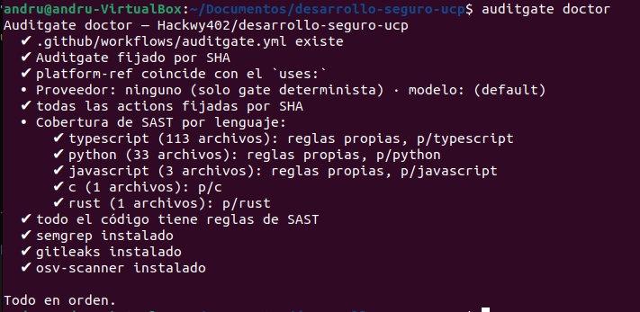
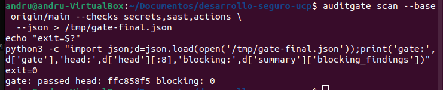
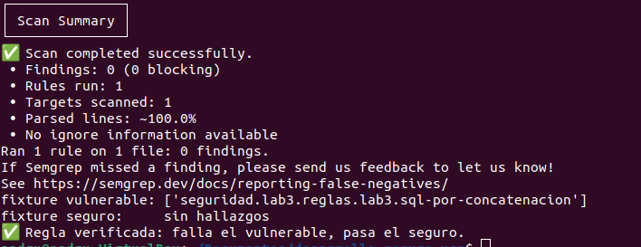
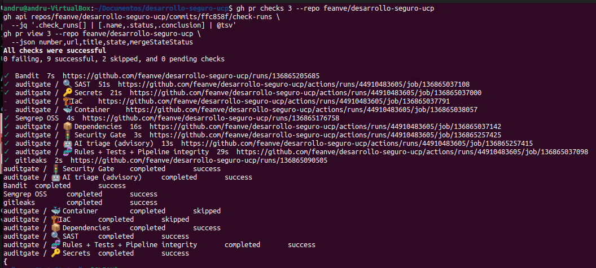

# Laboratorio 3 · Pipeline DevSecOps con SBOM y Firma de Artefactos

**Repositorio del estudiante:** [`feanve/desarrollo-seguro-ucp`](https://github.com/feanve/desarrollo-seguro-ucp)  
**Upstream del curso:** [`Hackwy402/desarrollo-seguro-ucp`](https://github.com/Hackwy402/desarrollo-seguro-ucp)  
**Rama de trabajo del PR:** `lab3/pr-bloqueo-verde` · **Rama base:** `origin/main` (`cf94312`)  
**Pull Request #3:** [feanve/desarrollo-seguro-ucp#3](https://github.com/feanve/desarrollo-seguro-ucp/pull/3)  
**Comentario de entrega / evidencia:** [feanve/desarrollo-seguro-ucp/pull/3#issuecomment-7063603006](https://github.com/feanve/desarrollo-seguro-ucp/pull/3#issuecomment-7063603006)

---

## 1. Pregunta Central y Tres Evidencias Complementarias

> **¿Cómo evitamos que una falla nueva llegue a `main` sin frenar al equipo por la deuda que ya existe?**

Para responder de forma robusta, se combinan tres fuentes de verdad complementarias:

| Fuente | Qué demuestra | Qué NO demuestra | Archivos de Evidencia |
|---|---|---|---|
| **Gate Determinista (Auditgate & Semgrep)** | Que lo nuevo introducido en un PR se bloquea si contiene fallas, mientras que la deuda previa se reporta sin frenar el merge. | Que el artefacto publicado sea exactamente el que se escaneó. | [`gate-*.json`](file:///home/andru/Documentos/desarrollo-seguro-ucp/seguridad/lab3/), [`TRIAGE.md`](file:///home/andru/Documentos/desarrollo-seguro-ucp/seguridad/lab3/TRIAGE.md), [`checks-bloqueado.txt`](file:///home/andru/Documentos/desarrollo-seguro-ucp/seguridad/lab3/checks-bloqueado.txt) |
| **SBOM CycloneDX (Trivy)** | Qué componentes directos y transitivos componen el artefacto y si registran CVEs conocidos. | Cómo ingresó el componente o quién firmó el artefacto. | [`SBOM.md`](file:///home/andru/Documentos/desarrollo-seguro-ucp/seguridad/lab3/SBOM.md), [`sbom.cdx.json`](file:///home/andru/Documentos/desarrollo-seguro-ucp/seguridad/lab3/sbom.cdx.json), [`trivy-sbom.json`](file:///home/andru/Documentos/desarrollo-seguro-ucp/seguridad/lab3/trivy-sbom.json) |
| **Firma + Provenance (Cosign / SLSA)** | Que el contenedor/artefacto fue construido por este pipeline y no fue sustituido ni adulterado. | Que el código fuente del artefacto carezca de vulnerabilidades. | [`FIRMA.md`](file:///home/andru/Documentos/desarrollo-seguro-ucp/seguridad/lab3/FIRMA.md), [`cosign.pub`](file:///home/andru/Documentos/desarrollo-seguro-ucp/seguridad/lab3/cosign.pub), [`firma-verificada.json`](file:///home/andru/Documentos/desarrollo-seguro-ucp/seguridad/lab3/firma-verificada.json) |

---

## 2. Índice General de Entregables en `seguridad/lab3/`

1. **Gate Determinista y Triaje:**
   * [`gate-deuda.json`](file:///home/andru/Documentos/desarrollo-seguro-ucp/seguridad/lab3/gate-deuda.json): Barrido inicial sobre `main` (14 hallazgos antiguos reportados).
   * [`gate-limpio.json`](file:///home/andru/Documentos/desarrollo-seguro-ucp/seguridad/lab3/gate-limpio.json): PR sin código vulnerable (gate `passed`, 0 hallazgos nuevos).
   * [`gate-bloqueado.json`](file:///home/andru/Documentos/desarrollo-seguro-ucp/seguridad/lab3/gate-bloqueado.json): PR con SQLi por concatenación en `buscar.py:15` (gate `blocked`, exit 1).
   * [`gate-final.json`](file:///home/andru/Documentos/desarrollo-seguro-ucp/seguridad/lab3/gate-final.json): PR con consulta parametrizada (gate `passed`, exit 0).
   * [`checks-bloqueado.txt`](file:///home/andru/Documentos/desarrollo-seguro-ucp/seguridad/lab3/checks-bloqueado.txt): Salida de GitHub Actions de la corrida fallida.
   * [`TRIAGE.md`](file:///home/andru/Documentos/desarrollo-seguro-ucp/seguridad/lab3/TRIAGE.md): Triaje ASVS 5.0 de hallazgos nuevos y deuda previa.
2. **Regla y Pruebas:**
   * [`reglas/sql-por-concatenacion.yml`](file:///home/andru/Documentos/desarrollo-seguro-ucp/seguridad/lab3/reglas/sql-por-concatenacion.yml): Regla Semgrep propia para detectar patrones de concatenación SQL.
   * [`reglas/fixtures/vulnerable.py`](file:///home/andru/Documentos/desarrollo-seguro-ucp/seguridad/lab3/reglas/fixtures/vulnerable.py) y [`reglas/fixtures/seguro.py`](file:///home/andru/Documentos/desarrollo-seguro-ucp/seguridad/lab3/reglas/fixtures/seguro.py).
   * [`reglas/test_regla.sh`](file:///home/andru/Documentos/desarrollo-seguro-ucp/seguridad/lab3/reglas/test_regla.sh): Script de verificación automatizada.
3. **SBOM CycloneDX:**
   * [`SBOM.md`](file:///home/andru/Documentos/desarrollo-seguro-ucp/seguridad/lab3/SBOM.md): Respuestas sobre inventario, Log4Shell (`CVE-2021-44228`), transitividad y remediación.
   * [`sbom.cdx.json`](file:///home/andru/Documentos/desarrollo-seguro-ucp/seguridad/lab3/sbom.cdx.json): Inventario en formato estándar CycloneDX.
   * [`trivy-sbom.json`](file:///home/andru/Documentos/desarrollo-seguro-ucp/seguridad/lab3/trivy-sbom.json): Cruce de vulnerabilidades CRITICAL con Trivy.
4. **Firma y Provenance:**
   * [`FIRMA.md`](file:///home/andru/Documentos/desarrollo-seguro-ucp/seguridad/lab3/FIRMA.md): Tabla comparativa local vs. keyless OIDC en CI y política de llaves.
   * [`cosign.pub`](file:///home/andru/Documentos/desarrollo-seguro-ucp/seguridad/lab3/cosign.pub): Llave pública de verificación (`cosign.key` ignorada en `.gitignore`).
   * [`firma-verificada.json`](file:///home/andru/Documentos/desarrollo-seguro-ucp/seguridad/lab3/firma-verificada.json): Verificación exitosa de la firma.
5. **Pull Request y Reflexión:**
   * [`PR.md`](file:///home/andru/Documentos/desarrollo-seguro-ucp/seguridad/lab3/PR.md): Cuerpo del PR con ASVS V1.14, amenaza mitigada y comandos de prueba.
   * [`REFLEXION.md`](file:///home/andru/Documentos/desarrollo-seguro-ucp/seguridad/lab3/REFLEXION.md): Reflexión sobre deuda vs. nuevo, valor de las tres evidencias y estrategia de trinquete (*ratchet*).
6. **Capturas de Terminal:**
   * [`capturas/`](file:///home/andru/Documentos/desarrollo-seguro-ucp/seguridad/lab3/capturas/): Capturas seleccionadas tomadas directamente en la terminal.

---

## 3. Instalación y Diagnóstico del Gate (§0)

Instalación con workflow fijado por SHA y verificación inicial:

```bash
auditgate doctor
```


*(Evidencia: [`01-auditgate-doctor.png`](file:///home/andru/Documentos/desarrollo-seguro-ucp/seguridad/lab3/capturas/01-auditgate-doctor.png))*

---

## 4. Estados del Gate Determinista (§1)

Comando local estándar ejecutado para la validación:
```bash
auditgate scan --base origin/main --checks secrets,sast,actions --json
```

| Estado | HEAD | Base | Resultado | Hallazgos Nuevos | Evidencia |
|---|---|---|---|---|---|
| **Deuda previa** | `cf94312` | `origin/main` (`cf94312`) | `blocked` | 14 antiguos | [`gate-deuda.json`](file:///home/andru/Documentos/desarrollo-seguro-ucp/seguridad/lab3/gate-deuda.json) |
| **PR limpio** | `cf94312` | `1483edd` (padre) | `passed` | 0 | [`gate-limpio.json`](file:///home/andru/Documentos/desarrollo-seguro-ucp/seguridad/lab3/gate-limpio.json) |
| **PR con falla nueva** | `8d58f8a` | `origin/main` (`cf94312`) | `blocked` | 2 bloqueantes | [`gate-bloqueado.json`](file:///home/andru/Documentos/desarrollo-seguro-ucp/seguridad/lab3/gate-bloqueado.json) |
| **PR corregido** | `7d92220` | `origin/main` (`cf94312`) | `passed` | 0 | [`gate-final.json`](file:///home/andru/Documentos/desarrollo-seguro-ucp/seguridad/lab3/gate-final.json) |


*(Evidencia: [`02-auditgate-scan-passed.png`](file:///home/andru/Documentos/desarrollo-seguro-ucp/seguridad/lab3/capturas/02-auditgate-scan-passed.png) - Scan final pasando con 0 hallazgos y exit 0)*

---

## 5. Regla Semgrep con Fixtures y Prueba (§3 y §4)

| Requisito ASVS 5.0 | Amenaza del Lab 1 Mitigada | Hallazgo del Gate | Control Implementado | Prueba de Verificación |
|---|---|---|---|---|
| **V1.14** (consultas parametrizadas en todo acceso a datos) | Inyección SQL en el buscador de usuarios | `auditgate.flask.sqli-string-built-query` y `tainted-sql-string` en `poc/buscar.py:15` | Parametrización estricta con `?` y tupla: `db.execute("... WHERE name = ?", (nombre,))` | `bash seguridad/lab3/reglas/test_regla.sh` (exit 0) |

Ejecución de la prueba automatizada:

```bash
bash seguridad/lab3/reglas/test_regla.sh
```


*(Evidencia: [`03-prueba-regla-fixtures.png`](file:///home/andru/Documentos/desarrollo-seguro-ucp/seguridad/lab3/capturas/03-prueba-regla-fixtures.png) - Falla el vulnerable, pasa el seguro)*

---

## 6. Verificación en GitHub Actions del PR #3

Ejecución en GitHub Actions verificada desde la CLI:

```bash
gh pr checks 3 --repo feanve/desarrollo-seguro-ucp
```


*(Evidencia: [`04-gh-pr-checks-passed.png`](file:///home/andru/Documentos/desarrollo-seguro-ucp/seguridad/lab3/capturas/04-gh-pr-checks-passed.png) - Todos los checks requeridos en estado verde)*

---

## 7. Inventario de Capturas Seleccionadas

| Archivo | Descripción | Rol en la entrega |
|---|---|---|
| [`01-auditgate-doctor.png`](file:///home/andru/Documentos/desarrollo-seguro-ucp/seguridad/lab3/capturas/01-auditgate-doctor.png) | Salida de `auditgate doctor` confirmando configuración y herramientas. | Verificación de ambiente (§0) |
| [`02-auditgate-scan-passed.png`](file:///home/andru/Documentos/desarrollo-seguro-ucp/seguridad/lab3/capturas/02-auditgate-scan-passed.png) | Salida de `auditgate scan` final pasando en verde tras la corrección. | Validación determinista del gate (§1) |
| [`03-prueba-regla-fixtures.png`](file:///home/andru/Documentos/desarrollo-seguro-ucp/seguridad/lab3/capturas/03-prueba-regla-fixtures.png) | Salida de `test_regla.sh` comprobando que la regla distingue código seguro de vulnerable. | Calidad de la regla SAST (§3) |
| [`04-gh-pr-checks-passed.png`](file:///home/andru/Documentos/desarrollo-seguro-ucp/seguridad/lab3/capturas/04-gh-pr-checks-passed.png) | Reporte de `gh pr checks 3` con todas las comprobaciones en éxito. | Cierre del PR en CI (§4) |
